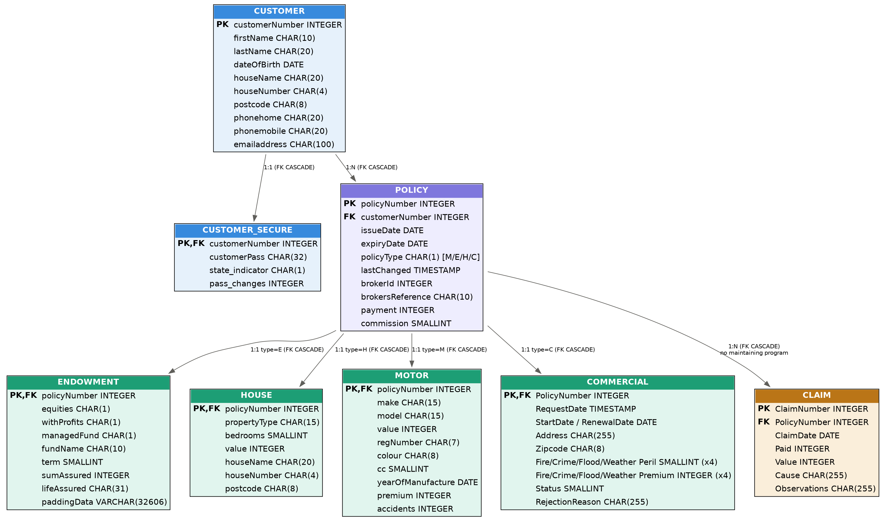

# Database Analysis — GenApp (General Insurance Application)
### Legacy Modernization Assessment

GenApp persists data across **two fundamentally different data-management technologies** plus a third category of non-persistent, operational data stores. This document inventories all three, maps every file/table and its keys, shows the relationships as an ERD, and provides an extracted, ready-to-run Db2 schema-creation script.

---

## 1. Data Management Types — Overview

| Type | Technology | Files / Tables | Nature |
|---|---|---|---|
| **Relational** | IBM **Db2** for z/OS | 8 tables (`customer`, `customer_secure`, `policy`, `endowment`, `house`, `motor`, `commercial`, `claim`) | System of record — full business-entity detail, referential integrity enforced by the DBMS |
| **Non-relational, key-sequential** | **VSAM** KSDS (Key-Sequenced Data Set) | 2 clusters (`KSDSCUST`, `KSDSPOLY`) | Secondary/legacy store — partial, denormalized records, direct-key access only, no browse/scan usage anywhere in the application |
| **Other — non-persistent / operational** | **CICS Temporary Storage (TSQ)** and **CICS Named Counters** | 3 TSQ queues (`GENAERRS`, `GENACNTL`, plus a shared-TSQ statistics queue used by `LGWEBST5`); 1 core named counter (`GENACUSTNUM`) + ~24 per-transaction-type named counters defined by `LGSETUP` | Transient/operational data — error logs, customer-number sequencing, and transaction-rate statistics. **Not** business data, and not queried by any inquiry function — write-and-forget from the business logic's perspective |

**No MQ, no file-system flat files, no IMS, and no other DBMS type exists in this codebase** (confirmed in the earlier Dependency Reference by scanning for MQ verbs — none found).

---

## 2. Db2 — Tables

| # | Table | Tablespace | Rows/Purpose | Primary Key | Foreign Key(s) |
|---|---|---|---|---|---|
| 1 | `customer` | GENATS00 | Party master | `customerNumber` (INTEGER, `IDENTITY`) | — |
| 2 | `customer_secure` | GENATS01 | 1:1 password/security row per customer (see caveat below) | `customerNumber` | `customerNumber` → `customer.customerNumber`, `ON DELETE CASCADE` |
| 3 | `policy` | GENATS02 | Policy/transaction master; `policyType` (M/E/H/C) discriminates the product line | `policyNumber` (INTEGER, `IDENTITY`) | `customerNumber` → `customer.customerNumber`, `ON DELETE CASCADE` |
| 4 | `endowment` | GENATS03 | Type-detail child, `policyType = 'E'` | `policyNumber` | `policyNumber` → `policy.policyNumber`, `ON DELETE CASCADE` |
| 5 | `house` | GENATS04 | Type-detail child, `policyType = 'H'` | `policyNumber` | `policyNumber` → `policy.policyNumber`, `ON DELETE CASCADE` |
| 6 | `motor` | GENATS05 | Type-detail child, `policyType = 'M'` | `policyNumber` | `policyNumber` → `policy.policyNumber`, `ON DELETE CASCADE` |
| 7 | `commercial` | GENATS06 | Type-detail child, `policyType = 'C'`; carries a 4-peril premium/status structure | `PolicyNumber` | `PolicyNumber` → `policy.policyNumber`, `ON DELETE CASCADE` |
| 8 | `claim` | GENATS07 | Claims against a policy — **no COBOL program in this package maintains this table** (flagged previously; confirm scope with the business) | `ClaimNumber` (INTEGER, `IDENTITY`) | `PolicyNumber` → `policy.policyNumber`, `ON DELETE CASCADE` |

**Full column lists, data types, and index definitions** for every table are in `genapp_db2_schema.sql` (delivered alongside this report) and summarized in the ERD below.

**Indexing:** every table has a `UNIQUE` clustering index on its primary key (`iCustomer`, `iCustomer_secure`, `iPolicy`, `iEndowment`, `iHouse`, `iMotor`, `iCommercial`, `iClaim`). `policy` additionally has a non-unique index (`iPolicy2`) on `customerNumber` to support the "list all policies for a customer" access pattern.

**Numbering strategy:** `customerNumber` uses Db2 `IDENTITY` as its default generator but the business logic (`LGACDB01`) prefers a coupling-facility **named counter** (`GENACUSTNUM`) first, falling back to `IDENTITY_VAL_LOCAL()` only if the named-counter server is unavailable (see Section 4). **`policyNumber` and `ClaimNumber` use Db2 `IDENTITY` only** — no named-counter fallback exists for either (this corrects an inference in the earlier Dependency Reference, which implied a parallel `GENAPOLNUM`-style counter for policy numbering; on closer inspection of `LGAPDB01`, no such counter call exists).

---

## 3. VSAM — Files

| File (CICS `FILE` resource) | Underlying data set | Organization | Key | Record Length | Programs |
|---|---|---|---|---|---|
| `KSDSCUST` | `<hlq>.GENAPP.KSDSCUST` | VSAM KSDS | First **10 bytes** = `customerNumber` | **225 bytes**, fixed | `LGACVS01` (write), `LGICVS01` (read), `LGUCVS01` (read+rewrite) |
| `KSDSPOLY` | `<hlq>.GENAPP.KSDSPOLY` | VSAM KSDS | First **21 bytes** = `policyType`(1) + `customerNumber`(10) + `policyNumber`(10) | **64 bytes**, fixed | `LGAPVS01` (write), `LGIPVS01` (read), `LGUPVS01` (read+rewrite), `LGDPVS01` (delete) |

### 3a. `KSDSCUST` record layout (verified against COBOL working storage — 10 + 215 = 225 bytes)
| Offset | Field | Length | Source |
|---|---|---|---|
| 1 | `customerNumber` | 10 | Key |
| 11 | `firstName` | 10 | |
| 21 | `lastName` | 20 | |
| 41 | `dateOfBirth` | 10 | |
| 51 | `houseName` | 20 | |
| 71 | `houseNumber` | 4 | |
| 75 | `postcode` | 8 | |
| 83 | `numPolicies` | 3 | |
| 86 | `phoneMobile` | 20 | |
| 106 | `phoneHome` | 20 | |
| 126 | `emailAddress` | 100 | |
| **Total** | | **225** | matches `RECORDSIZE(225 225)` in `adef121.jcl` |

### 3b. `KSDSPOLY` record layout (verified — 21-byte key + 43-byte type-specific data = 64 bytes)
| Offset | Field | Length |
|---|---|---|
| 1 | `policyType` (part of key) | 1 |
| 2 | `customerNumber` (part of key) | 10 |
| 12 | `policyNumber` (part of key) | 10 |
| 22 | **type-specific data** (`REDEFINES`, 43 bytes, meaning depends on `policyType`) | 43 |

The 43-byte type-specific area is a `REDEFINES` structure — **not a full mirror of the Db2 detail row**, only a lightweight subset:
| `policyType` | Fields packed into the 43 bytes |
|---|---|
| `C` (Commercial) | `postcode`(8), `status`(4), `customer name`(31) |
| `E` (Endowment) | `withProfits`(1), `equities`(1), `managedFund`(1), `fundName`(10), `lifeAssured`(30) |
| `H` (House) | `propertyType`(15), `bedrooms`(3), `value`(8), `postcode`(8), `houseName`(9) |
| `M` (Motor) | `make`(15), `model`(15), `value`(6), `regNumber`(7) |

**Key finding:** VSAM is not a full-fidelity replica of Db2 — it's a **partial secondary index/cache** carrying only enough fields to satisfy a direct-key inquiry without a Db2 round-trip. Any modernization that plans to retire VSAM must confirm no consumer depends on VSAM-only fields (there don't appear to be any — every VSAM field is a subset of its Db2 counterpart) and must account for the fact that VSAM data is **strictly narrower** than Db2 data per record.

**No sequential/browse access exists** — every VSAM operation in the codebase (`READ`, `WRITE`, `REWRITE`, `DELETE`) uses direct keyed access; `STARTBR`/`READNEXT`/`ENDBR` never appear.

---

## 4. Other Data Stores (Non-Relational, Non-VSAM)

| Store | Type | Name(s) | Written By | Read By | Purpose |
|---|---|---|---|---|---|
| Error/diagnostic log | CICS TSQ | `GENAERRS` | `LGSTSQ` (called from 20 of 31 programs) | Operations/ diagnostics only (not read by any business program) | Structured failure log: date, time, program, customer/policy number, SQLCODE |
| Customer-number range control | CICS TSQ | `GENACNTL` | `LGTESTC1` (`WRITE-GENACNTL` paragraph), initialized by `LGSETUP` | WSIM / operational tooling | Tracks low/high customer number range generated in a session, for Workload Simulator bookkeeping |
| Transaction statistics | Shared CICS TSQ | (written by `LGWEBST5`, initialized as `GENASTAT`/`GENASTRT` by `LGSETUP`) | `LGWEBST5` (every 60 seconds) | Monitoring/CICSPlex SM WUI | Running transaction-rate counters, for operational dashboards |
| Customer numbering | CICS **Named Counter** | `GENACUSTNUM` (pool `GENA`) | `LGACDB01` (`Obtain-CUSTOMER-Number`) | Same program, immediately | Coupling-facility-backed unique customer-number generator, preferred over Db2 `IDENTITY` when available |
| Per-transaction-type counters | CICS **Named Counters** | ~24 counters defined by `LGSETUP` (e.g. `GENA01ICUS00`–`99`, `GENA01ACUS00`–`99`, `GENA01IMOT00`–`99`, `GENA01AMOT00`–`99`, `GENA01DMOT00`–`99`, `GENA01UMOT00`–`99`, and equivalents per policy type) | `LGSETUP` (define), `LGASTAT1` (increment) | `LGWEBST5` (aggregate/report) | Per-request-type transaction volume counters supporting the CICS Event Processing / statistics capability |

**None of these are "databases" in the modernization-target sense** — they hold no durable business entities, are not queried by any Inquire/Report function, and would typically map to an application log stream, a metrics/monitoring system (e.g., Prometheus counters), and a distributed ID generator (e.g., a Snowflake-style sequence or the target database's own auto-increment) in a modern architecture, respectively — not to another relational table.

---

## 5. Entity Relationship Diagram (Db2)



**Relationship summary:**

| Parent | Child | Cardinality | FK Enforcement |
|---|---|---|---|
| `customer` | `customer_secure` | 1 : 0..1 | `ON DELETE CASCADE` |
| `customer` | `policy` | 1 : N | `ON DELETE CASCADE` |
| `policy` | `endowment` | 1 : 0..1 (only when `policyType = 'E'`) | `ON DELETE CASCADE` |
| `policy` | `house` | 1 : 0..1 (only when `policyType = 'H'`) | `ON DELETE CASCADE` |
| `policy` | `motor` | 1 : 0..1 (only when `policyType = 'M'`) | `ON DELETE CASCADE` |
| `policy` | `commercial` | 1 : 0..1 (only when `policyType = 'C'`) | `ON DELETE CASCADE` |
| `policy` | `claim` | 1 : N | `ON DELETE CASCADE`, but **no program writes to this table** |

**Important:** the four type-detail tables (`endowment`/`house`/`motor`/`commercial`) are mutually exclusive at the application level (a given `policy` row has exactly one matching detail row, selected by `policyType`), but **Db2 itself does not enforce this exclusivity** — there is no CHECK constraint tying `policyType` to "exactly one of these four child rows exists." A modernized schema (or the current one, as a hardening step) should consider adding that constraint or replacing the four-table pattern with a single polymorphic `policy_detail` table plus an enforced discriminator.

*A VSAM key-structure diagram was not included as a second ERD panel — VSAM is not a relational store and has no foreign-key relationships; its two files' key structures are fully documented in tables 3a/3b above, and their relationship to Db2 is "denormalized partial cache of `customer`/`policy` + type-detail," not a formal database relationship.*

---

## 6. Database Creation Script

A cleaned, portable version of the Db2 DDL — extracted from `JCL/db2cre.jcl`, with the JCL job-control wrapper, `RUN PROGRAM(DSNTIAD)` boilerplate, and ~800 lines of demo seed-data `INSERT` statements stripped out, leaving only the schema-defining SQL (storage group, database, tablespaces, 8 `CREATE TABLE` statements with full column lists and constraints, 8 indexes, and grants) — is provided as a companion file: **`genapp_db2_schema.sql`**.

Placeholders to substitute before running: `<DB2DBID>` (target database name), `<DB2RUN>` (VCAT/storage catalog), `<SQLID>` is set separately per the original JCL and was omitted here since it's a session setting, not schema DDL.

```sql
-- Excerpt — full script in genapp_db2_schema.sql
CREATE TABLE <DB2DBID>.policy (
     policyNumber     INTEGER NOT NULL GENERATED BY DEFAULT AS IDENTITY
                       (START WITH 1000001, INCREMENT BY 1, CACHE 20),
     customerNumber   INTEGER NOT NULL,
     issueDate        DATE,
     expiryDate       DATE,
     policyType       CHAR(1),
     lastChanged      TIMESTAMP NOT NULL WITH DEFAULT,
     brokerId         INTEGER,
     brokersReference CHAR(10),
     payment          INTEGER,
     commission       SMALLINT,
   PRIMARY KEY (policyNumber),
   FOREIGN KEY (customerNumber)
          REFERENCES <DB2DBID>.customer (customerNumber)
          ON DELETE CASCADE)
   CCSID EBCDIC
   IN <DB2DBID>.GENATS02;
```

For the VSAM equivalent of "schema creation," the defining statements are the two IDCAMS `DEFINE CLUSTER` commands in `JCL/adef121.jcl`:

```
DEFINE CLUSTER(NAME(<USRHLQ>.GENAPP.KSDSCUST) INDEXED VOLUME(SYSDAV) CYL(100 30)
        SHR(3) LOG(UNDO) FREESPACE(10 10) REUSE)
     DATA(NAME(<USRHLQ>.GENAPP.KSDSCUST.DATA) KEYS(10 0) RECORDSIZE(225 225) CISZ(8000))
    INDEX(NAME(<USRHLQ>.GENAPP.KSDSCUST.INDEX))

DEFINE CLUSTER(NAME(<USRHLQ>.GENAPP.KSDSPOLY) INDEXED VOLUME(SYSDAV) CYL(100 30)
        SHR(3) LOG(UNDO) FREESPACE(10 10) REUSE)
     DATA(NAME(<USRHLQ>.GENAPP.KSDSPOLY.DATA) KEYS(21 0) RECORDSIZE(64 64) CISZ(8000))
    INDEX(NAME(<USRHLQ>.GENAPP.KSDSPOLY.INDEX))
```

There is no "creation script" for the TSQ/Named-Counter stores in Section 4 in the same sense — CICS Temporary Storage Models (`TSMODEL`) and Named Counter definitions are created via `CEDA DEFINE`/CSD entries in `cdef121.jcl` (e.g. `GENASTST` TSMODEL), not DDL.

---

## 7. Caveats

- **Placeholder values** (`<DB2DBID>`, `<DB2RUN>`, `<DB2SSID>`, `<DB2PLAN>`, `<SQLID>`, `<USRHLQ>`, `<SYSDAV>` volume) are install-time JCL symbolic substitutions in the source and are preserved as-is in the extracted script — they must be resolved to real values before execution, they are not defaults.
- **Seed/demo data was intentionally excluded** from the delivered script — the original `db2cre.jcl` also contains ~800 lines of sample `INSERT` statements populating all 8 tables with test data (visible in the source if needed), which is appropriate for a demo install but not schema definition.
- **The VSAM record layouts in Section 3** were reconstructed from COBOL `WORKING-STORAGE` field definitions (`WF-Policy-Info`, customer `COMMAREA` REDEFINES) cross-checked against the `RECORDSIZE`/`KEYS` clauses in `adef121.jcl` — byte offsets were verified to sum correctly (225 and 64 bytes respectively) but were not confirmed against an actual compiled load module or live file.
- **The ERD graphic reflects Db2 only.** VSAM's two flat KSDS files have no relational structure to diagram — they are documented as key/record-layout tables instead (Section 3), which is the correct representation for that technology.
- **Db2 does not enforce policy-type-detail exclusivity** (see Section 5) — this is an application-level rule (which `LGTESTPn`/`LGAPOL01` the request came through) that a modernized schema should consider making explicit.
- **`claim` and `customer_secure` are structurally present but functionally orphaned** in different ways: `claim` has no maintaining COBOL program at all; `customer_secure` is written on every customer add but never read back by any program (see the Business Rules report, Section 2). Both are flagged again here because they materially affect how "complete" the Db2 schema should be treated during migration — schema completeness does not imply functional completeness.
- **No compiled-DBD/bind-plan artifacts were available** to verify the DDL against the actual bind (`db2bind.jcl` binds a plan/packages referencing this schema but does not itself alter table structure) — this analysis reflects `db2cre.jcl` as the authoritative schema source, consistent with how the application is actually built per `DOCUMENTATION/Building.md`.

---

*Generated from static analysis of `JCL/db2cre.jcl` (Db2 DDL), `JCL/adef121.jcl` (VSAM DEFINE CLUSTER), and COBOL working-storage record layouts (`LGACVS01`, `LGAPVS01`, `LGUPVS01`, and related VSAM-tier programs) in the uploaded source package. ERD rendered from the extracted schema; companion files `genapp_db2_erd.png` and `genapp_db2_schema.sql` are delivered alongside this report.*
